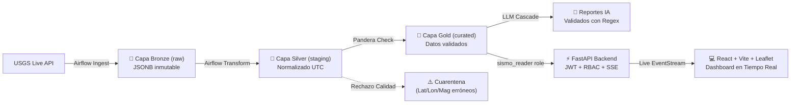

# 🌍 SismoWatch PDD — Monitoreo Sísmico y Automatización con IA (SuperApp)

> **Prueba de Desempeño — Ruta de IA y Automatización**  
> Sistema integral de ingestión en streaming, procesamiento bajo arquitectura Medallion, calidad de datos con Pandera, cascada de IA generativa con validador anti-alucinaciones numérico y dashboard reactivo con Server-Sent Events.

---

## 📋 Resumen Ejecutivo

SismoWatch es una plataforma diseñada para que los equipos operativos y de logística de **SuperApp** tomen decisiones preventivas en tiempo real ante eventos sísmicos a nivel global y regional.

El sistema monitoriza continuamente los feeds oficiales del Servicio Geológico de los Estados Unidos (**USGS**), normaliza y valida los datos mediante contratos estrictos de esquema (desviando anomalías a una **Zona de Cuarentena**), detecta enjambres sísmicos mediante **Z-Score** y genera boletines ejecutivos automatizados mediante una **cascada de IA multi-modelo** (Gemini -> Groq -> Plantilla) protegida contra alucinaciones numéricas.

---

## 🏗️ Arquitectura del Sistema

El flujo de datos sigue el estándar industrial **Medallion Architecture** sobre PostgreSQL 16 con aislamiento estricto de roles de base de datos (Mínimo Privilegio):



Para ver la documentación completa y detallada de la arquitectura, consulta [docs/ARQUITECTURA.md](docs/ARQUITECTURA.md).

---

## 🚀 Puesta en Marcha en Frío (Un Solo Comando)

Para desplegar y verificar el sistema completo de punta a punta (Postgres, API, Frontend, Ingesta inicial de datos en vivo de USGS y reporte IA):

```bash
bash scripts/bootstrap.sh
```

El script ejecutará automáticamente:
1. Verificación y generación de secretos criptográficos en `.env`.
2. Despliegue de los contenedores Docker (`postgres`, `api`, `web`).
3. Espera de healthchecks en base de datos y backend.
4. Ingesta inicial en vivo de USGS hacia Bronze, Silver y Gold con validación Pandera.
5. Inyección de sismo de prueba en cuarentena para auditoría forense.
6. Siembra del reporte ejecutivo de IA en base de datos.
7. Impresión de credenciales de acceso y URLs operativas.

---

## 🌐 Servicios y Puertos

| Servicio | URL / Puerto | Descripción | Healthcheck |
|---|---|---|---|
| **Frontend Web** | [http://localhost:3000](http://localhost:3000) | Dashboard React, Leaflet Map, Recharts y SSE | Nginx Static SPA |
| **API Backend** | [http://localhost:8000](http://localhost:8000) | FastAPI REST API, JWT RBAC y Streaming | `GET /health` |
| **Swagger Docs** | [http://localhost:8000/docs](http://localhost:8000/docs) | Documentación interactiva OpenAPI | `GET /docs` |
| **PostgreSQL 16** | `localhost:5432` | Base de datos relacional Medallion | `pg_isready` |
| **Airflow Web** | [http://localhost:8080](http://localhost:8080) | Orquestador de DAGs y Pipelines | Airflow Webserver |

---

## 🔐 Credenciales y Roles de Acceso (RBAC)

Las contraseñas se generan de forma aleatoria y segura en el archivo `.env`. Puedes consultarlas con `cat .env | grep PASSWORD` o usar las variables cargadas:

| Rol | Usuario | Permisos de Sistema | Comprobación RBAC |
|---|---|---|---|
| **Administrador** | `admin` | Acceso total: KPIs, Eventos, Reportes IA, **Panel de Cuarentena** y Disparo de Remediaciones | Acceso autorizado `200 OK` en `/api/quality/quarantine` |
| **Visualizador** | `viewer` | Solo lectura operativa: KPIs, Eventos, Mapa en vivo, Reportes IA | Acceso denegado `403 Forbidden` en `/api/quality/quarantine` |

---

## 🧪 Suite de Pruebas Automatizadas (Pytest)

El proyecto cuenta con **31 pruebas automatizadas** de extremo a extremo que cubren todas las capas críticas del sistema:

```bash
# Ejecutar la suite completa de pruebas:
./.venv/bin/pytest -v
```

### Cobertura de Pruebas:
- `tests/test_transformations.py`: Aplanamiento de GeoJSON, conversión a UTC ISO-8601, sanitización y casteo defensivo.
- `tests/test_dags_integrity.py`: Validación de sintaxis e integridad estructural de los 4 DAGs de Airflow.
- `tests/test_quality_quarantine.py`: Contrato de esquema Pandera, desvío automático de registros corruptos (latitud `150.0`) a cuarentena sin frenar el flujo.
- `tests/test_api_auth.py`: Emisión y validación de tokens JWT, rechazo `401` anónimo, bloqueo `403` a viewers en cuarentena, y protección AST contra inyecciones SQL.
- `tests/test_ai_validator.py`: Validación numérica por Regex, detección y rechazo de alucinaciones de magnitud y falsas alertas de tsunami.
- `tests/test_idempotency.py`: Comprobación de que re-ejecuciones múltiples no duplican registros en PostgreSQL (`ON CONFLICT DO UPDATE`).

---

## 🛡️ Auditoría de Seguridad

Para auditar el repositorio contra vulnerabilidades, fugas de secretos y análisis estático de código:

```bash
bash scripts/run_security_scan.sh
```

Los reportes generados se encuentran en:
- `docs/security/bandit_report.txt`: Análisis Estático de Seguridad de Código (SAST) con Bandit.
- `docs/security/pip_audit_report.txt`: Análisis de dependencias y vulnerabilidades conocidas (CVEs) con pip-audit.
- `docs/security/gitleaks_report.txt`: Detección de secretos y credenciales con Gitleaks.

---

## 💡 Bono: Asistente IA Text-to-SQL con Salvaguarda AST

La API incorpora el endpoint `POST /api/ai/query` que permite a los analistas formular preguntas en lenguaje natural (ej. *"¿Cuáles fueron los 5 sismos más fuertes de magnitud mayor a 5?"*).

### Salvaguarda de Seguridad por AST (Abstract Syntax Tree):
1. La consulta SQL generada se descompone en un árbol sintáctico mediante `sqlparse`.
2. Se valida que la sentencia sea unívocamente de tipo `SELECT`.
3. Se rechazan intentos de inyección o comandos destructivos (`DROP`, `TRUNCATE`, `ALTER`, `INSERT`, `UPDATE`, `DELETE`).
4. La ejecución se realiza bajo el rol de base de datos `sismo_reader` (solo lectura a nivel de motor PostgreSQL).

---

## 📚 Documentación de Sustentación

- [docs/ARQUITECTURA.md](docs/ARQUITECTURA.md): Especificación técnica exhaustiva, diagramas Mermaid, esquema de roles PostgreSQL y diseño de resiliencia.
- [docs/DEFENSA.md](docs/DEFENSA.md): **Guía con 15 preguntas y respuestas técnicas** para la defensa de la prueba ante comités evaluadores.
- [docs/REQUISITOS_PDD.md](docs/REQUISITOS_PDD.md): Requisitos de negocio originales y matriz de criterios de aceptación.
- [CHANGELOG.md](CHANGELOG.md): Registro cronológico y trazabilidad de todas las fases implementadas.
