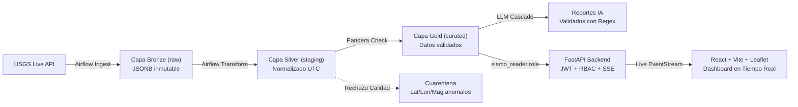

# SismoWatch PDD — Monitoreo Sismico y Automatizacion con IA (SuperApp)

> **Prueba de Desempeno — Ruta de IA y Automatizacion**  
> Plataforma integral de ingenieria de datos para ingestion continua, procesamiento bajo arquitectura Medallion, calidad deterministica con Pandera, cascada de IA multimodelo protegida por AST y validador anti-alucinaciones numerico, con consola de observabilidad minimalista basada en Server-Sent Events.

---

## Resumen Ejecutivo

SismoWatch es una plataforma empresarial disenada para que los equipos operativos y de logistica de SuperApp tomen decisiones preventivas en tiempo real ante eventos sismicos a nivel global y regional.

El sistema monitoriza continuamente los feeds oficiales del Servicio Geologico de los Estados Unidos (USGS), normaliza y valida los datos mediante contratos estrictos de esquema (aislando anomalias en una Zona de Cuarentena auditada), detecta enjambres sismicos mediante formulas geodesicas Haversine y Z-Score, y provee analisis predictivo y consultivo mediante SismoBot: un asistente Text-to-SQL con salvaguarda AST y cascada multi-proveedor (Groq gpt-oss-120b y Gemini Flash con respaldo determinista).

---

## Arquitectura del Sistema

El flujo de datos sigue el estandar industrial Medallion Architecture sobre PostgreSQL 16 con aislamiento estricto de roles de base de datos segun el principio de minimo privilegio (PoLP):



Para la especificacion tecnica completa, consultar [docs/ARQUITECTURA.md](docs/ARQUITECTURA.md).

---

## Puesta en Marcha (Un Solo Comando)

Para desplegar y verificar el sistema completo de extremo a extremo (PostgreSQL, Airflow, API FastAPI, Frontend React, ingesta inicial en vivo de USGS y reporte IA):

```bash
bash scripts/bootstrap.sh
```

El script ejecutara automaticamente:
1. Verificacion y generacion de secretos criptograficos en `.env`.
2. Despliegue de los contenedores Docker (`postgres`, `api`, `web`).
3. Verificacion de estado y healthchecks en base de datos y backend.
4. Ingesta inicial en vivo de USGS hacia Bronze, Silver y Gold con validacion Pandera.
5. Inyeccion controlada de sismo en cuarentena para auditoria forense.
6. Siembra del reporte ejecutivo de IA en base de datos.
7. Impresion de credenciales de acceso y URLs de servicio.

---

## Servicios y Puertos

| Servicio | URL / Puerto | Descripcion | Healthcheck |
|---|---|---|---|
| **Frontend Web** | [http://localhost:3000](http://localhost:3000) | Dashboard React, Leaflet Satellite Map, Recharts y SSE | Nginx Static SPA |
| **API Backend** | [http://localhost:8000](http://localhost:8000) | FastAPI REST API, JWT RBAC y Streaming | `GET /health` |
| **Documentacion OpenAPI** | [http://localhost:8000/docs](http://localhost:8000/docs) | Swagger UI interactivo | `GET /docs` |
| **PostgreSQL 16** | `localhost:5432` | Base de datos relacional Medallion | `pg_isready` |
| **Apache Airflow** | [http://localhost:8080](http://localhost:8080) | Orquestador de DAGs y Pipelines | Airflow Webserver |

---

## Modelo de Seguridad y Roles de Acceso (RBAC)

El acceso a la plataforma y sus endpoints esta estrictamente gobernado por perfiles de usuario y tokens JWT con expiracion temporal:

| Capacidad / Vista | Visitante (sin login) | Viewer (Analista) | Admin (Auditor) |
|---|---|---|---|
| Ver Landing Page Informativa | Si | Si | Si |
| Ver Dashboard Operativo (KPIs, Graficos, Mapa) | No | Si | Si |
| Ver Eventos en Tiempo Real (SSE Stream) | No | Si | Si |
| Ver y Exportar Reportes (CSV / HTML / Impresion) | No | Si | Si |
| Consultar SismoBot IA (Text-to-SQL AST Guard) | No | Si | Si |
| Ver Estado del Pipeline (Resumen de Calidad) | No | Si (resumen) | Si (detalle) |
| Ver Registros en Cuarentena de Calidad | No | No (403 Forbidden) | Si |
| Disparar DAGs Airflow (Ingesta, Backfill, IA) | No | No (403 Forbidden) | Si |

### Roles de Base de Datos PostgreSQL:
- `sismo_ingest`: Solo permisos INSERT/UPDATE en esquema `raw`.
- `sismo_transform`: Lectura en `raw`, lectura/escritura en `staging` y `curated`.
- `sismo_reader`: Unicamente SELECT en esquemas `curated` y vistas analiticas. Sin permisos DDL ni DML en ninguna tabla.

---

## Suite de Pruebas Automatizadas (Pytest)

El proyecto cuenta con **35 pruebas automatizadas** de extremo a extremo que validan la solidez de cada componente del sistema:

```bash
# Ejecutar la suite completa de pruebas:
.venv/bin/pytest tests/ -v
```

### Cobertura de la Suite:
- `tests/test_transformations.py`: Aplanamiento de GeoJSON, conversion a UTC ISO-8601, sanitizacion y casteo defensivo.
- `tests/test_dags_integrity.py`: Validacion sintactica e integridad estructural de los 4 DAGs de Airflow.
- `tests/test_quality_quarantine.py`: Contrato de esquema Pandera, desvio automatico de registros corruptos a cuarentena con persistencia del payload crudo y regla violada.
- `tests/test_api_auth.py`: Ciclo de vida JWT, rechazo 401 a anonimos, bloqueo estricto 403 a usuarios viewer en cuarentena, y proteccion AST contra inyecciones SQL.
- `tests/test_ai_validator.py`: Validacion numerica deterministica por expresiones regulares, deteccion y rechazo de alucinaciones en magnitudes, fechas o conteos.
- `tests/test_idempotency.py`: Verificacion de que re-ejecuciones no duplican registros en PostgreSQL (`ON CONFLICT (id) DO UPDATE`).
- `tests/test_lineage_and_swarms.py`: Calculo de distancias geodesicas Haversine, deteccion de enjambres sismicos por radio y conciliacion matematica de volumenes.

---

## Auditoria de Seguridad y Calidad de Codigo

Para auditar el codigo contra vulnerabilidades, fugas de credenciales y analisis estatico:

```bash
bash scripts/run_security_scan.sh
```

Los reportes se generan en el directorio `docs/security/`:
- `bandit_report.txt`: Analisis Estatico de Seguridad de Codigo (SAST) con Bandit.
- `pip_audit_report.txt`: Escaneo de dependencias contra bases de datos de vulnerabilidades conocidas (CVEs).
- `gitleaks_report.txt`: Deteccion y prevencion de fuga de secretos y claves criptograficas.

---

## Motor de Inteligencia Artificial SismoBot

La plataforma cuenta con un agente analitico integrado que permite formular consultas en lenguaje natural o sentencias SQL directas sobre la capa Gold certificada.

### Caracteristicas Principales:
1. **Cascada Multi-Proveedor Resiliente**:
   - Primario: Groq (`openai/gpt-oss-120b`) para traduccion y generacion con latencia inferior a un segundo.
   - Respaldo: Google Gemini 3.8 Flash si el proveedor primario no esta disponible.
   - Falla segura: Motor de reglas y expresiones regulares que garantiza respuesta deterministica sin caida de servicio.
2. **Salvaguarda AST (Abstract Syntax Tree)**:
   - Toda consulta SQL generada se analiza sintacticamente con `sqlparse`.
   - Se valida unicamente sentencias de lectura `SELECT`.
   - Se rechaza categoricamente cualquier token `DROP`, `DELETE`, `UPDATE`, `INSERT`, `ALTER` o `TRUNCATE`.
3. **Validacion Anti-Alucinacion**:
   - El archivo `validator.py` contrasta las cifras extraidas del texto generado por el LLM contra las metricas deterministicas calculadas en base de datos.
   - En caso de discrepancia, el sistema descarta la respuesta del LLM y emplea plantillas seguras predefinidas.

---

## Diseno Visual e Interfaz de Usuario

La interfaz fue construida desde cero bajo un enfoque minimalista y de alto rendimiento tecnico, eliminando ruido visual y elementos genericos:

- **Paleta Cromatica Sobria**:
  - Mocha Brown (`#120e0d`, `#171211`, `#1e1715`): Fondo calido profundo y tarjetas de contraste suave.
  - Platinum Silver (`#f7f7f9`, `#ececf1`, `#9b9baa`): Tipografia legible de alta fidelidad.
  - Pale Lavender (`#d5c4fb`, `#844dea`, `#9f73f2`): Acentos operativos y destacados analiticos.
- **Cartografia Satelital Tactica**:
  - Integracion de mosaicos satelitales globales de alta definicion (Esri World Imagery) y modos de alto contraste (CartoDB Dark).
  - Clustering geodesico por severidad energetica: verde (< 3.0), amarillo (3.0 a 4.5), naranja (4.5 a 6.0) y carmesi (>= 6.0).
  - Identificacion visual de enjambres sismicos anomalos.
- **Transiciones Fluidas**:
  - Curvas de aceleracion suaves (`cubic-bezier(0.16, 1, 0.3, 1)`).
  - Drawer lateral para consultas conversacionales de IA sin superposiciones ni colapso de componentes.

---

## Guia de Evidencias de Entrega

Para la evaluacion del proyecto en plataforma:
1. **Dashboard Operativo**: Vista principal con KPIs consolidados, mapa satelital Leaflet y feed en vivo transmitido por Server-Sent Events.
2. **Consola de Cuarentena (Admin)**: Vista exclusiva para rol administrador mostrando eventos rechazados por limites geograficos con visor de payload JSON original.
3. **Boletin Ejecutivo y Exportacion**: Informe sintetico con sello de aprobacion anti-alucinacion y exportacion a formato imprimible / PDF.
4. **Airflow Webserver (`http://localhost:8080`)**: Monitor de ejecucion de DAGs (`dag_ingesta_usgs`, `dag_transformacion_calidad`, `dag_backfill_historico`, `dag_reporte_ia_anomalias`).
5. **Grafo de Linaje y Conciliacion**: Pestaña de gobernanza con representacion de los 8 nodos de la arquitectura Medallion y validacion formal de la ecuacion de conciliacion.

---

## Documentacion Tecnica de Referencia

- [docs/ARQUITECTURA.md](docs/ARQUITECTURA.md): Especificacion de ingenieria, diagramas de secuencia, esquema de bases de datos y acuerdos de nivel de servicio.
- [docs/DEFENSA.md](docs/DEFENSA.md): Banco de 18 preguntas tecnicas fundamentales para la sustentacion ante comité evaluador.
- [docs/REQUISITOS_PDD.md](docs/REQUISITOS_PDD.md): Matriz de requerimientos obligatorios y criterios de aceptacion.
- [docs/security/](docs/security/): Informes detallados de auditoria de seguridad automatica.
- [CHANGELOG.md](CHANGELOG.md): Registro cronologico de cambios y evoluciones del proyecto.
