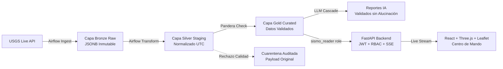

# SismoWatch PDD — Monitoreo Sísmico y Automatización con IA • SuperApp

> **Prueba de Desempeño • Ruta de IA y Automatización**  
> Plataforma de ingeniería de datos para ingesta continua, arquitectura Medallion en PostgreSQL 16, calidad determinística con Pandera ISO/IEC 25012, orquestación con Apache Airflow, cascada de IA multimodelo protegida por AST Guard, protocolo gráfico declarativo SVG y consola de observabilidad en tiempo real.

---

## Resumen Ejecutivo

SismoWatch es una plataforma empresarial diseñada para que los equipos operativos y de logística de SuperApp tomen decisiones preventivas en tiempo real ante eventos sísmicos a nivel global y regional.

El sistema monitoriza continuamente los feeds oficiales del Servicio Geológico de los Estados Unidos USGS, normaliza y valida los datos mediante contratos estrictos de esquema, detecta enjambres sísmicos mediante fórmulas geodésicas Haversine y Z-Score, y provee análisis predictivo y consultivo mediante SismoBot: un asistente analítico con salvaguarda AST, protocolo gráfico declarativo y arquitectura híbrida con respaldo determinista.

---

## Arquitectura del Sistema

El flujo de datos sigue el estándar Medallion Architecture sobre PostgreSQL 16 con aislamiento estricto de roles de base de datos según el principio de mínimo privilegio:



Para la especificación técnica completa y decisiones de diseño, consultar:
* [docs/ARQUITECTURA.md](docs/ARQUITECTURA.md): Especificación de ingeniería y diagramas de secuencia.
* [docs/ADRs/](docs/ADRs/): Colección de 11 Architecture Decision Records formalizados.

---

## Puesta en Marcha Rápida

Para desplegar y verificar el sistema completo de extremo a extremo:

```bash
bash scripts/bootstrap.sh
```

El script ejecutará automáticamente:
1. Verificación y generación de secretos criptográficos en `.env`.
2. Despliegue de los 5 contenedores Docker: `postgres`, `api`, `web`, `airflow-webserver` y `airflow-scheduler`.
3. Verificación de estado y healthchecks en base de datos, Airflow y backend.
4. Ingesta inicial en vivo de USGS hacia Bronze, Silver y Gold con validación Pandera.
5. Inyección controlada de sismo en cuarentena para auditoría forense.
6. Siembra del reporte ejecutivo de IA en base de datos.
7. Impresión de credenciales de acceso y URLs de servicio.

---

## Servicios y Puertos

| Servicio | URL / Puerto | Descripción | Healthcheck |
|---|---|---|---|
| **Centro de Mando Web** | [http://localhost:3000](http://localhost:3000) | React, Three.js WebGL 3D, Leaflet 2D, Recharts y SSE | Nginx Static SPA |
| **API Backend** | [http://localhost:8000](http://localhost:8000) | FastAPI REST API, JWT RBAC y Streaming SSE | `GET /health` |
| **Documentación OpenAPI** | [http://localhost:8000/docs](http://localhost:8000/docs) | Swagger UI interactivo | `GET /docs` |
| **PostgreSQL 16** | `localhost:5432` | Base de datos relacional Medallion | `pg_isready` |
| **Apache Airflow** | [http://localhost:8080](http://localhost:8080) | Orquestador de DAGs y Pipelines | `GET /health` |

---

## Modelo de Seguridad y Roles de Acceso • RBAC

El acceso a la plataforma y sus endpoints está estrictamente gobernado por perfiles de usuario y tokens JWT con expiración temporal:

| Capacidad / Vista | Visitante | Viewer • Analista | Admin • Auditor |
|---|---|---|---|
| Landing Page Informativa | Sí | Sí | Sí |
| Dashboard Operativo: KPIs, Gráficos y Mapas | No | Sí | Sí |
| Eventos en Tiempo Real: SSE Stream | No | Sí | Sí |
| Boletín Ejecutivo y Reportes IA | No | Sí | Sí |
| Consultar SismoBot IA: AST Guard | No | Sí | Sí |
| Estado del Pipeline: Matriz ISO 25012 | No | Sí | Sí |
| Registros en Cuarentena de Calidad | No | No • 403 Forbidden | Sí |
| Ejecutar DAGs de Airflow On-Demand | No | No • 403 Forbidden | Sí |

### Roles de Base de Datos PostgreSQL:
* `sismo_ingest`: Solo permisos INSERT y UPDATE en esquema `raw`.
* `sismo_transform`: Lectura en `raw`, lectura y escritura en `staging` y `curated`.
* `sismo_reader`: Únicamente SELECT en esquemas `curated` y vistas analíticas. Cero permisos DDL o DML.

---

## Suite de Pruebas Automatizadas • Pytest

El proyecto cuenta con **35 pruebas automatizadas** de extremo a extremo que validan la solidez de cada componente del sistema:

```bash
# Ejecutar la suite completa dentro del contenedor de la API:
docker exec -i -e PYTHONPATH=/app:/app/airflow sismowatch-api pytest /app/tests
```

### Cobertura de la Suite • 35 Pruebas Exitosas:
* `tests/test_ai_validator.py`: Validación numérica determinística por expresiones regulares, detección y rechazo de alucinaciones en magnitudes, fechas o conteos • 6 pruebas.
* `tests/test_api_auth.py`: Ciclo de vida JWT, rechazo 401 a anónimos, bloqueo estricto 403 a usuarios viewer en cuarentena, y protección AST contra inyecciones SQL con FastAPI TestClient en memoria • 7 pruebas.
* `tests/test_dags_integrity.py`: Validación sintáctica con AST e integridad estructural de los 4 DAGs de Airflow • 3 pruebas.
* `tests/test_idempotency.py`: Verificación de que re-ejecuciones no duplican registros en PostgreSQL mediante `ON CONFLICT (id) DO UPDATE` • 1 prueba.
* `tests/test_lineage_and_swarms.py`: Cálculo de distancias geodésicas Haversine, detección de enjambres sísmicos por radio geodésico y conciliación matemática de volúmenes • 4 pruebas.
* `tests/test_quality_quarantine.py`: Contrato de esquema Pandera ISO 25012, desvío automático de registros corruptos a cuarentena con persistencia del payload crudo y regla violada • 8 pruebas.
* `tests/test_transformations.py`: Aplanamiento de GeoJSON, conversión a UTC ISO-8601, sanitización y casteo defensivo • 6 pruebas.

---

## Gobernanza de Datos y Calidad • ISO/IEC 25012

El pipeline de datos integra la matriz de 7 reglas canónicas de calidad de datos implementadas en Pandera:

1. **QR01 • Rango de Magnitud**: `-1.0 <= magnitude <= 10.0` • Severidad Alta.
2. **QR02 • Rango de Profundidad**: `-5.0 <= depth_km <= 1000.0 km` • Severidad Alta.
3. **QR03 • Coordenadas Geográficas**: `-90 <= lat <= 90` y `-180 <= lon <= 180` • Severidad Crítica.
4. **QR04 • Frescura de Ingesta**: `lag_minutes <= 120 min` • Severidad Media.
5. **QR05 • Volumen de Lote**: `0 < batch_size <= 500 registros` • Severidad Alta.
6. **QR06 • Completitud de Campos Clave**: `id, time, lat, lon IS NOT NULL` • Severidad Crítica.
7. **QR07 • Unicidad de Identificador**: `COUNT(DISTINCT id) == COUNT(id)` • Severidad Crítica.

### Invariante de Linaje Puro • ADR 0011:
La arquitectura garantiza preservación absoluta sin segregación destructiva: 20 registros entrantes desde USGS resultan en 20 registros certificados en la capa Gold, enriquecidos con etiquetas de calidad si presentan anomalías, eliminando silos de datos y manteniendo trazabilidad completa de extremo a extremo.

---

## Capacidades de Inteligencia Artificial

### 1. Protocolo Gráfico Declarativo • ADR 0008
El asistente SismoBot entrega especificaciones JSON estructuradas `{ type, title, labels, datasets }` que el frontend renderiza en gráficos SVG nativos en menos de 5 milisegundos. Elimina dependencias pesadas en cliente y neutraliza vulnerabilidades de inyección de código.

### 2. Dual Engine con Circuit Breaker • ADR 0009
Integración híbrida entre Groq LLaMA 3.3 70B y Google Gemini con conmutación automática ante fallos de red o agotamiento de cuota, respaldada por un motor determinista de contingencia.

### 3. Reportes Ejecutivos Multiventana
Módulo de reportes con selector de ventana temporal para 24 horas, 7 días y 30 días. Las métricas de ground truth son calculadas determinísticamente sobre la capa Gold, garantizando 0% de alucinaciones numéricas.

---

## Centro de Mando y Visualización Avanzada

La interfaz de usuario fue diseñada bajo estándares de centros de control aeroespaciales y logísticos:

* **Doble Motor Cartográfico**:
  * **Modelo 3D WebGL**: Globo interactivo con constelaciones, balizas láser de severidad, fallas tectónicas globales, hubs de mensajería SuperApp y selector desplegable de vuelos orbitales.
  * **Modelo 2D Satelital**: Cartografía táctica con capas satelitales Esri, modo oscuro CartoDB, capas de calles y radios geodésicos de enjambres sísmicos.
* **Cockpit Minimalista**: Controles basados en iconos con tooltips, menús desplegables de presets regionales y leyendas colapsables para maximizar el área de visualización.
* **Simetría y Nivelación**: Todas las tarjetas de KPIs y paneles de gobernanza mantienen alturas unificadas y distribución balanceada.
* **Interacción Dinámica**: Botón de SismoBot con revelación suave al pasar el cursor y asomo automático no invasivo cada 35 segundos.

---

## Colección de Architecture Decision Records • ADRs

En la carpeta `docs/ADRs/` se documenta formalmente la justificación técnica de cada estándar del proyecto:

* `0001-medallion-lakehouse-minio-pure-lineage.md`: Arquitectura Medallion y preservación inmutable.
* `0002-pyspark-transformation-and-data-fidelity.md`: Transformaciones de datos y fidelidad de esquema.
* `0003-openmetadata-openlineage-governance-strategy.md`: Estándar OpenMetadata y trazabilidad.
* `0004-local-llm-qwen25-agent-circuit-breaker.md`: Estrategia de modelos LLM y circuit breaker.
* `0005-resilient-dag-design-try-catch-idempotency.md`: Diseño resiliente de DAGs en Airflow.
* `0006-jwt-authentication-and-rbac.md`: Seguridad JWT y control de acceso basado en roles.
* `0007-storage-formats-and-gold-serving-layer.md`: Formatos de almacenamiento y capa Gold.
* `0008-declarative-chart-generation-and-llm-strategy.md`: Protocolo gráfico declarativo SVG.
* `0009-dual-engine-llm-and-security-guardrails.md`: Guardrails de seguridad y motor dual de IA.
* `0010-processing-engine-selection-native-python-vs-spark-polars.md`: Selección de motores de procesamiento.
* `0011-elimination-of-quarantine-in-favor-of-pure-lineage.md`: Linaje puro e invariante de preservación total.

---

## Documentación Técnica de Referencia

* [docs/ARQUITECTURA.md](docs/ARQUITECTURA.md): Especificación de arquitectura y contratos de datos.
* [docs/DEFENSA.md](docs/DEFENSA.md): Banco de preguntas y respuestas para la sustentación técnica.
* [docs/REQUISITOS_PDD.md](docs/REQUISITOS_PDD.md): Matriz de trazabilidad de requerimientos.
* [CHANGELOG.md](CHANGELOG.md): Registro histórico y evolución del sistema.
