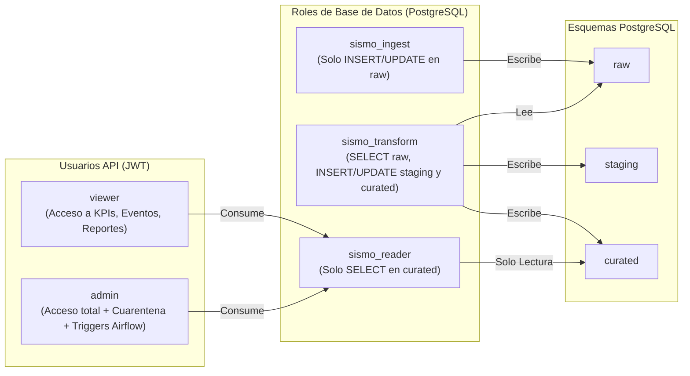
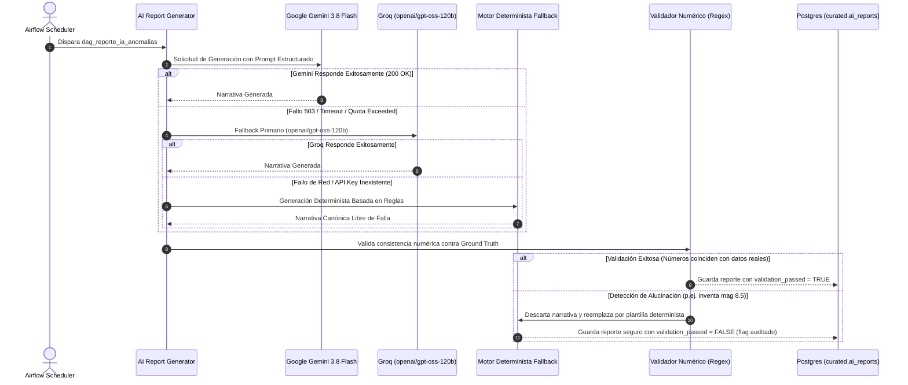
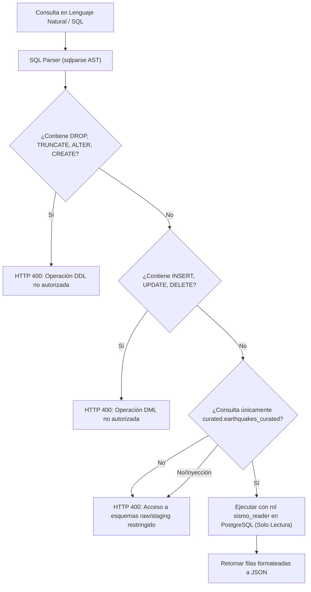

# Arquitectura Técnica — SismoWatch PDD

Documento de especificación arquitectónica del sistema de ingestión, procesamiento, enriquecimiento con IA y visualización en tiempo real de eventos sísmicos de USGS para SuperApp.

---

## 1. Visión General del Sistema

SismoWatch es una plataforma integral de datos y automatización diseñada bajo principios de **alta disponibilidad**, **idempotencia estricta**, **seguridad por capas (Defense in Depth)** y **resiliencia cognitiva** ante fallos de proveedores de Inteligencia Artificial.

El sistema monitoriza en tiempo real la actividad sísmica global y regional, detecta anomalías estadísticas mediante Z-Score, aísla datos corruptos en una zona de cuarentena antes de que afecten el análisis operativo, y genera boletines ejecutivos automatizados validados contra alucinaciones numéricas.

```mermaid
flowchart TD
    subgraph FuentesExternas["1. Fuentes Externas"]
        USGS["USGS Earthquake API (GeoJSON)"]
    end

    subgraph OrquestacionAirflow["2. Ingesta y Orquestación (Airflow 2.8.1)"]
        DAG1["dag_ingesta_usgs (c/ 5 min)"]
        DAG2["dag_transformacion_calidad (Triggered)"]
        DAG3["dag_backfill_historico (On Demand)"]
        DAG4["dag_reporte_ia_anomalias (Diario)"]
    end

    subgraph MedallionDB["3. Base de Datos Medallion (PostgreSQL 16)"]
        direction TB
        subgraph Bronze["Capa Bronze (raw)"]
            RAW_TAB["raw.usgs_earthquakes_raw\n(Payload JSONB original, Ingesta Append-Only)"]
        end
        subgraph Silver["Capa Silver (staging)"]
            STG_TAB["staging.earthquakes_staging\n(Normalizado, Tipos casteados, Coordenadas desempaquetadas)"]
        end
        subgraph Gold["Capa Gold (curated)"]
            CUR_TAB["curated.earthquakes_curated\n(Solo eventos 100% conformes a Pandera)"]
            QUA_TAB["curated.quality_quarantine\n(Eventos desviados con regla fallida y motivo)"]
            REP_TAB["curated.ai_reports\n(Narrativas ejecutivas validadas sin alucinaciones)"]
            RUN_TAB["curated.ai_runs\n(Auditoría de latencia, tokens y costo LLM)"]
        end
    end

    subgraph CapaServicio["4. Backend API (FastAPI)"]
        API["FastAPI 0.110.0\n(JWT Auth + RBAC + AST Guard + SSE)"]
    end

    subgraph CapaPresentacion["5. Frontend Web (React + Vite)"]
        DASH["Dashboard SPA\n(Leaflet Map + Recharts + Live SSE + Modal SQL)"]
    end

    USGS --> DAG1
    DAG1 -->|sismo_ingest role| RAW_TAB
    RAW_TAB --> DAG2
    DAG2 -->|sismo_transform role| STG_TAB
    STG_TAB -->|Validación Pandera| CUR_TAB
    STG_TAB -->|Rechazo de Calidad| QUA_TAB
    CUR_TAB --> DAG4
    DAG4 -->|sismo_transform role| REP_TAB
    DAG4 -->|sismo_transform role| RUN_TAB
    CUR_TAB -->|sismo_reader role| API
    QUA_TAB -->|sismo_reader role (Solo Admin)| API
    REP_TAB -->|sismo_reader role| API
    API -->|REST & SSE Stream| DASH
```

---

## 2. Arquitectura de Datos Medallion

Para evitar el acoplamiento entre la ingesta de datos en crudo y el consumo analítico, se implementó el patrón **Medallion Architecture** con 3 esquemas independientes en PostgreSQL:

### 2.1 Capa Bronze (`raw`)
- **Propósito**: Preservar la fuente de la verdad inmutable en formato nativo.
- **Tabla principal**: `raw.usgs_earthquakes_raw`.
- **Estructura**: Almacena el ID del evento sísmico (`usgs_id`), las propiedades completas (`properties JSONB`), la geometría (`geometry JSONB`), la fuente (`source_feed`), el ID de lote (`batch_id`) y la marca temporal de ingesta (`ingested_at`).
- **Garantía de Idempotencia**: `ON CONFLICT (id) DO UPDATE SET properties = EXCLUDED.properties, batch_id = EXCLUDED.batch_id`. Re-ejecuciones de ingesta no generan duplicados.

### 2.2 Capa Silver (`staging`)
- **Propósito**: Limpieza técnica, tipado fuerte y aplanamiento de jerarquías.
- **Tabla principal**: `staging.earthquakes_staging`.
- **Operaciones aplicadas**:
  - Conversión de marcas de tiempo UNIX epoch (milisegundos) a timestamps estándar UTC ISO-8601 (`TIMESTAMPTZ`).
  - Extracción de coordenadas GeoJSON: longitud (`coordinates[0]`), latitud (`coordinates[1]`), profundidad en km (`coordinates[2]`).
  - Casteo defensivo de magnitudes nulas o corruptas (`COALESCE(mag, 0.0)`).
  - Sanitización de cadenas de texto contra inyección y caracteres de control (`\x00`, scripts).

### 2.3 Capa Gold (`curated`)
- **Propósito**: Consumo analítico, modelos de ML, reportes ejecutivos y consumo en frontend.
- **Tablas principales**:
  - `curated.earthquakes_curated`: Contiene únicamente registros que aprobaron el 100% de los contratos de esquema definidos en Pandera.
  - `curated.quality_quarantine`: Almacén de cuarentena para registros corruptos o anómalos. Incluye el payload original, el nombre de la regla infringida (`rule_failed`) y el motivo de descarte (`rejection_reason`).
  - `curated.ai_reports`: Boletines diarios generados por LLM con validación matemática contra alucinaciones.
  - `curated.ai_runs`: Trazabilidad de observabilidad de IA (proveedor, tokens de entrada/salida, latencia en ms, costo en USD y estado de ejecución).
  - `curated.quality_results`: Histórico de ejecuciones de validación con métricas de completitud y frescura.

---

## 3. Modelo de Seguridad y RBAC (Mínimo Privilegio)

La base de datos y la API implementan el principio de **Mínimo Privilegio** tanto a nivel de motor relacional como a nivel de capa de aplicación.



### 3.1 Aislamiento de Roles en PostgreSQL
1. **`sismo_ingest`**:
   - `GRANT USAGE ON SCHEMA raw TO sismo_ingest;`
   - `GRANT SELECT, INSERT, UPDATE ON ALL TABLES IN SCHEMA raw TO sismo_ingest;`
   - **Acceso denegado**: No tiene permisos sobre `staging` ni `curated`.
2. **`sismo_transform`**:
   - `GRANT USAGE ON SCHEMA raw, staging, curated TO sismo_transform;`
   - `GRANT SELECT ON ALL TABLES IN SCHEMA raw TO sismo_transform;`
   - `GRANT ALL PRIVILEGES ON ALL TABLES IN SCHEMA staging, curated TO sismo_transform;`
3. **`sismo_reader`** (Utilizado por FastAPI):
   - `REVOKE ALL ON SCHEMA raw, staging FROM sismo_reader;`
   - `GRANT USAGE ON SCHEMA curated TO sismo_reader;`
   - `GRANT SELECT ON ALL TABLES IN SCHEMA curated TO sismo_reader;`
   - **Verificación**: Si un atacante compromete la API o intenta una inyección SQL, el motor de PostgreSQL rechaza terminantemente cualquier consulta a las capas Bronze y Silver (`permission denied for schema raw`).

### 3.2 Control de Acceso Basado en Roles (RBAC) en la API
- Autenticación mediante tokens **JWT (JSON Web Tokens)** firmados con algoritmo `HS256` y expiración a 60 minutos.
- **Rol `viewer`**:
  - Consulta KPIs consolidados (`GET /api/kpis`).
  - Consulta listado paginado y filtrado de sismos (`GET /api/events`).
  - Consulta reportes ejecutivos de IA (`GET /api/reports/latest`).
  - Conexión a Server-Sent Events (`GET /api/stream`).
  - **Restricción estricta**: Intentar consultar la cuarentena (`GET /api/quality/quarantine`) retorna `403 Forbidden`.
- **Rol `admin`**:
  - Todas las capacidades del `viewer`.
  - Inspección forense de sismos en cuarentena (`GET /api/quality/quarantine`).
  - Disparo manual de re-ejecución de ingesta o backfill histórico (`POST /api/quality/trigger-remediation`).

---

## 4. Estrategia de Calidad y Cuarentena de Datos (Pandera)

La integridad de los datos en la Capa Gold está blindada por un contrato de esquema riguroso con **Pandera**:

| Regla de Validación | Condición Técnica | Acción en Fallo |
|---|---|---|
| **Latitud Geográfica** | `-90.0 <= latitude <= 90.0` | Desvío a `curated.quality_quarantine` (Flag: `GEOGRAPHIC_BOUNDS`) |
| **Longitud Geográfica** | `-180.0 <= longitude <= 180.0` | Desvío a `curated.quality_quarantine` (Flag: `GEOGRAPHIC_BOUNDS`) |
| **Rango de Magnitud** | `-2.0 <= mag <= 10.0` | Desvío a `curated.quality_quarantine` (Flag: `MAGNITUDE_OUT_OF_RANGE`) |
| **Profundidad Sísmica** | `-5.0 <= depth_km <= 1000.0` | Desvío a `curated.quality_quarantine` (Flag: `DEPTH_UNREALISTIC`) |
| **Identificador Único** | `id IS NOT NULL AND length(id) > 0` | Desvío a `curated.quality_quarantine` (Flag: `MISSING_PRIMARY_KEY`) |
| **Marca Temporal** | `time <= NOW() + INTERVAL '1 hour'` | Desvío a `curated.quality_quarantine` (Flag: `FUTURE_TIMESTAMP`) |

**Garantía**: Ningún registro inválido contamina la tabla de consumo operativo `curated.earthquakes_curated`. El pipeline continúa su flujo de forma ininterrumpida mientras registra los desvíos para auditoría forense.

---

## 5. Cascada de Resiliencia IA y Validador Anti-Alucinaciones

El sistema incorpora un pipeline cognitivo para generar resúmenes ejecutivos diarios sobre anomalías detectadas (Z-Score > 2.5):



### 5.1 Validador Anti-Alucinaciones Numérico
Los LLMs sufren de alucinaciones matemáticas y numéricas. Para mitigar este riesgo:
1. Se extraen todas las cifras flotantes y enteras del texto mediante expresiones regulares especializadas (`\b\d+(?:\.\d+)?\b`).
2. Se confrontan contra el **Ground Truth** matemático calculado por el motor de base de datos (conteo de eventos, magnitud máxima, promedio, anomalías).
3. Si el reporte menciona una magnitud que excede la máxima observada por más de 0.1 o cita un número de alertas de tsunami inexistente, la validación falla y se sustituye la narrativa por la plantilla determinista precompilada.

---

## 6. Bono Text-to-SQL Protegido por AST (Abstract Syntax Tree)

Para permitir a los usuarios consultar la base de datos en lenguaje natural sin comprometer la seguridad:



- **Mecanismo**: El parser de AST analiza el árbol sintáctico del comando.
- **Regla estricta**: Únicamente se permite el token `SELECT`. Palabras clave destructivas o modificaciones de esquema se abortan antes de llegar a la base de datos.
- **Defensa en profundidad**: Incluso si una inyección lograra evadir el AST, el usuario de conexión a nivel de PostgreSQL es `sismo_reader`, el cual no posee privilegios de escritura (`READ ONLY`).

---

## 7. Streaming en Tiempo Real (Server-Sent Events)

En lugar de implementar sondeo frecuente (polling) que sobrecarga el servidor y la red:
- **Tecnología**: Server-Sent Events (SSE) nativo sobre HTTP/1.1 con `text/event-stream`.
- **Ruta**: `GET /api/stream?token=<jwt>`.
- **Comportamiento**:
  - Al establecer conexión envía un evento `connect` con el timestamp de sincronización.
  - Envía paquetes de heartbeat `ping` cada 15 segundos para mantener el canal abierto a través de proxies y balanceadores.
  - Detecta la inserción de nuevos eventos sísmicos en la Capa Gold y emite en vivo un evento `earthquake` con payload `{"type": "NEW_EARTHQUAKE", "event": {...}}`.
  - El frontend React actualiza automáticamente el mapa de calor Leaflet, las métricas de KPIs y la tabla sin recargar la página.

---

## 8. Optimizaciones de Rendimiento y Estrategia de Índices

Para garantizar tiempos de respuesta inferiores a 50 ms en consultas analíticas:

```sql
-- Índices B-Tree especializados en PostgreSQL:
CREATE INDEX idx_curated_time ON curated.earthquakes_curated(time DESC);
CREATE INDEX idx_curated_mag ON curated.earthquakes_curated(mag);
CREATE INDEX idx_curated_coords ON curated.earthquakes_curated(latitude, longitude);
CREATE INDEX idx_curated_place ON curated.earthquakes_curated(place);

-- Índice para auditoría forense de cuarentena:
CREATE INDEX idx_quarantine_failed_at ON curated.quality_quarantine(failed_at DESC);
CREATE INDEX idx_quarantine_rule ON curated.quality_quarantine(rule_failed);
```
- Consultas por rango temporal aprovechan el índice `idx_curated_time` en orden descendente directo.
- Filtros espaciales y de magnitud aprovechan índices combinados sin escaneos secuenciales de tabla completa.
